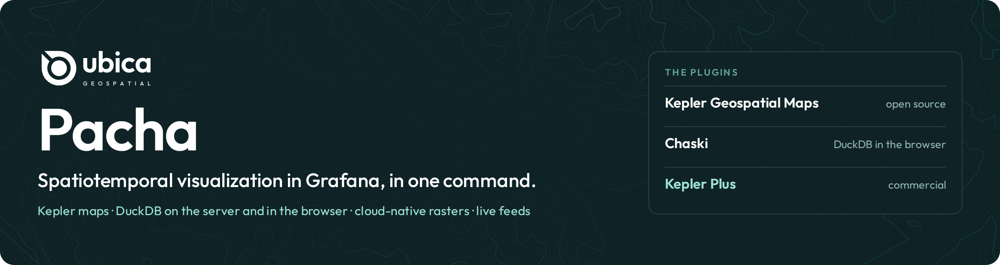
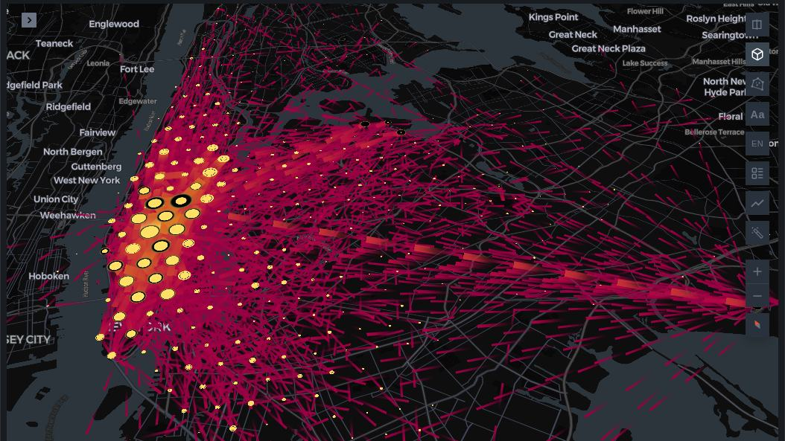
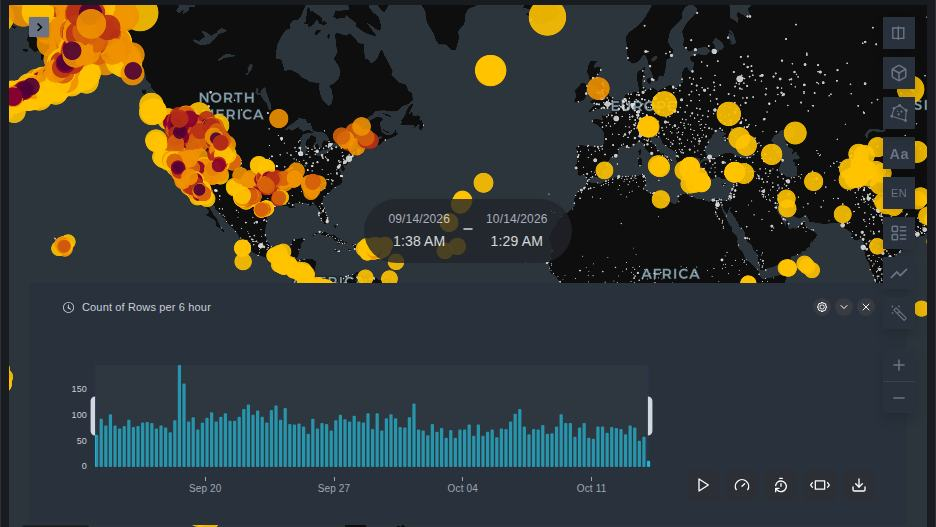
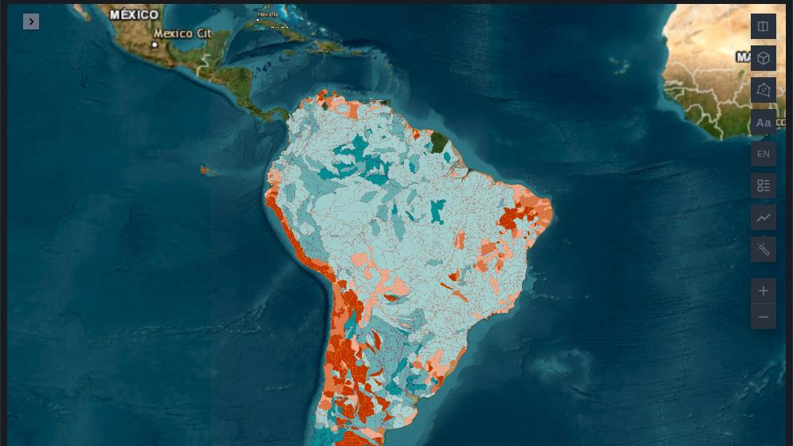
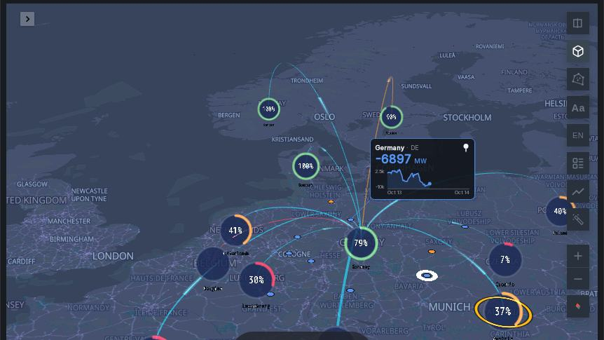
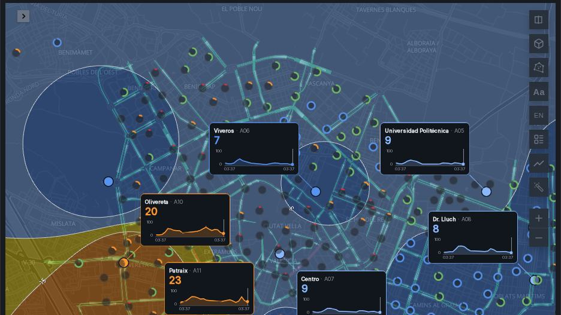
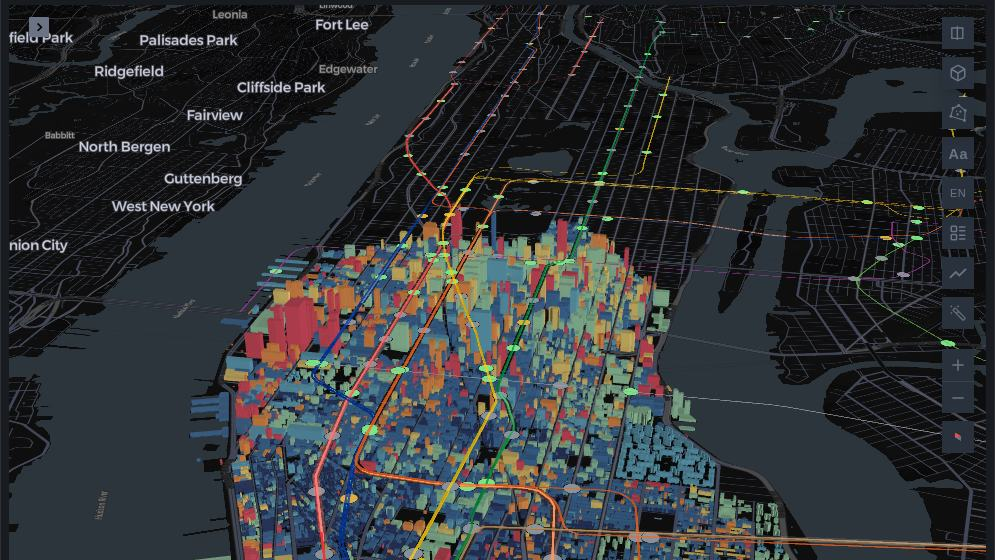

<a href="https://pacha.ubica.dev"></a>

*Pacha* is Quechua for the world and time as one.

Spatiotemporal visualization in Grafana, in one command: maps of moving things, sensors and
imagery, queried with DuckDB on the server or in the browser, from data read where it is
published. Made for the questions of [smart cities, digital twins, accessibility, mobility and
fleets](#what-it-is-for).

**🌍 [Live gallery](https://pacha.ubica.dev)**: every dashboard in this repository, running.
No account needed.

> Not affiliated with Grafana Labs.

<table>
<tr>
<td width="33%"><a href="https://pacha.ubica.dev/d/nyc-taxi-live"></a><br><sub><b>New York City taxis, live</b> · DuckDB</sub></td>
<td width="33%"><a href="https://pacha.ubica.dev/d/earthquakes"></a><br><sub><b>Earthquakes, the last 30 days</b> · Chaski</sub></td>
<td width="33%"><a href="https://pacha.ubica.dev/d/aqueduct-sa"></a><br><sub><b>Water risk in South America</b> · ArcGIS, live</sub></td>
</tr>
<tr>
<td><a href="https://pacha.ubica.dev/d/germany-power-borders"></a><br><sub><b>Germany's power borders, live</b> · Plus</sub></td>
<td><a href="https://pacha.ubica.dev/d/fiware-valencia"></a><br><sub><b>València in real time, on FIWARE</b> · Plus</sub></td>
<td><a href="https://pacha.ubica.dev/d/nyc-skyline-plus"></a><br><sub><b>Manhattan by height and by subway, in 3D</b> · Plus</sub></td>
</tr>
</table>

## What it is for

The questions a city, a utility or a fleet operator asks of data that has a place and a time,
answered in Grafana, live or over history. Each example runs in the
[live gallery](https://pacha.ubica.dev); those marked *Plus* need Kepler Plus.

**Smart cities.** A city's sensors, counters and open-data feeds on one map, under one time
window. [València on FIWARE](https://pacha.ubica.dev/d/fiware-valencia) (*Plus*) reads traffic,
air quality, weather and shared bikes as NGSI-LD entities from a FIWARE context broker;
[Melbourne's street sensors](https://pacha.ubica.dev/d/melbourne-city-sensors) (*Plus*) its
parking bays, pedestrian counters and microclimate stations;
[Los Angeles freeways](https://pacha.ubica.dev/d/caltrans-la-cameras) (*Plus*) every traffic
camera with its live video, the lane closures and the message signs;
[Paris by bike](https://pacha.ubica.dev/d/paris-bike-counters) every bike counter, hour by hour.

**Digital twins.** The place in 3D, with its networks and what happens on them.
[Manhattan in 3D](https://pacha.ubica.dev/d/nyc-skyline-plus) (*Plus*) raises 22,324 buildings to
their roof heights with the subway running above them;
[AGI headquarters](https://pacha.ubica.dev/d/agi-hq-grid-cameras) (*Plus*) lays a simulated grid and
the field of view of every security camera on a photogrammetric 3D Tiles mesh;
[Wildfires near the power grid](https://pacha.ubica.dev/d/wildfires-power-grid) (*Plus*) measures
every satellite fire detection against the high-voltage lines.

**Accessibility analysis.** Who reaches what, and how fast.
[Cuenca accessibility analysis](https://pacha.ubica.dev/d/cuenca-accessibility) (*Plus*) has R5
(Conveyal) time every street from two places you drag, or from one place in two ways of
travelling (by bike, on foot, by bus and tram, with or without the slope of the terrain), and
counts the people, stops, parks, schools and hospitals within reach, minute by minute; it needs
an R5 instance, which pacha.ubica.dev has.
[Manhattan, by height and by subway](https://pacha.ubica.dev/d/nyc-skyline) shows how much of the
city stands within walking distance of a train.

**Mobility.** How people and vehicles move, from raw positions to flows.
[Spain on the move](https://pacha.ubica.dev/d/spain-daily-mobility) (*Plus*) maps every trip
between Spain's municipalities on a day, counted from mobile phones;
[GeoLife](https://pacha.ubica.dev/d/geolife-mobility) (*Plus*) cleans 24.9 million GPS fixes into
trips, stops and flows; [Ships around Denmark](https://pacha.ubica.dev/d/denmark-ais-trajectories)
(*Plus*) turns AIS positions into stops, trips and encounters at sea;
[New York City taxis, live](https://pacha.ubica.dev/d/nyc-taxi-live) replays a week of trips as
flows between neighbourhoods.

**Fleet monitoring.** Every vehicle where it is now, with its recent history and its telemetry.
[MBTA](https://pacha.ubica.dev/d/gtfs-rt-mbta-fleet) and
[TriMet](https://pacha.ubica.dev/d/trimet-live-fleet) (both *Plus*) follow buses and trains from GTFS
Realtime, with punctuality, service changes and alerts;
[Air traffic, worldwide](https://pacha.ubica.dev/d/air-traffic-world) (*Plus*) every aircraft
adsb.lol hears; [Delivery drone flights](https://pacha.ubica.dev/d/drone-delivery-flights) and
[a GPS truck](https://pacha.ubica.dev/d/gps-truck-track-plus) (both *Plus*) replay each trip with
its speed and height, and the drone's energy.

## The plugins

Pacha is the showcase and the test bench of three Grafana plugins made by
[Ubica](https://github.com/ubica-ecuador):

| Plugin | What it is | License |
|--------|------------|---------|
| [Kepler Geospatial Maps](https://github.com/ubica-ecuador/keplergl-grafana-panel) | [kepler.gl](https://kepler.gl) maps in a Grafana panel, fed by any data source: points, trips, origin–destination flows, H3, cloud-native imagery. [Documentation](https://docs.ubica.dev) | Apache-2.0, baked into the image |
| [Chaski](https://github.com/ubica-ecuador/chaski) | DuckDB in the browser (DuckDB-WASM) as a Grafana data source: load a dashboard's data once, then filter, group and join it in milliseconds. An app that also brings a [Mosaic](https://idl.uw.edu/mosaic/) panel: linked views whose brushes filter each other in the browser. | Apache-2.0, baked into the image |
| [Kepler Geospatial Maps Plus](https://docs.ubica.dev/plus/) | The commercial edition of the Kepler panel, for operations maps: gauges, sparkline cards, live fleets, network links and 3D tiles, each drawn with its own time series. [In the Grafana plugin catalog](https://grafana.com/grafana/plugins/ubica-keplerplus-app/) | Commercial, closed source; **not** in this repository or its images |

Around them the image bakes in the
[DuckDB data source](https://github.com/motherduckdb/grafana-duckdb-datasource) for queries on
the server, [Infinity](https://github.com/grafana/grafana-infinity-datasource), and
[Business Charts](https://grafana.com/grafana/plugins/volkovlabs-echarts-panel/), Table, Text and Variable. A
[TiTiler](https://developmentseed.org/titiler/) serves the imagery.

The free stack runs every dashboard in `dashboards/`. The dashboards in `plus/dashboards/` need
Kepler Plus; without it they are not loaded (see [Kepler Plus](#kepler-plus)).

## Run it

```bash
docker compose up --wait
```

Open <http://localhost:3000>. Anonymous visitors can view; sign in as `admin` / `admin` to edit (set
`GF_SECURITY_ADMIN_PASSWORD` in `.env`, starting from `.env.example`). Is port 3000 taken? Run
`STACK_PORT=3100 docker compose up --wait`. When the stack is reached under another host name (not localhost), set `GF_SERVER_ROOT_URL` in `.env` to that URL — Grafana Live checks browser origins against it.

## Dashboards

Grafana's Git Sync keeps the dashboards in `dashboards/` (and `plus/dashboards/`
with the Plus overlay) in step with Grafana. A public instance (`PACHA_REPO_TYPE=github`) also syncs
Chaski's examples, read-only, into a "Chaski plugin" folder: the Mosaic gallery, density, Gaia and
New York taxi dashboards, which live in the [Chaski repo](https://github.com/ubica-ecuador/chaski/tree/main/examples). In dev, a save in Grafana, from the
UI or from an agent through MCP, writes the file in this clone; commit it like
any other change. Run once per clone, so Grafana may write there:

```bash
scripts/dev-acl.sh
```

On a public instance, set `PACHA_REPO_TYPE=github` and `PACHA_GIT_TOKEN` in
`.env` (see `.env.example`): Grafana then follows `main` on GitHub and commits
each save to it. Folders, tags and conventions: [dashboards/README.md](dashboards/README.md).

The home page is a dashboard too, `dashboards/home.json`: every dashboard of the Gallery and
of Plus as a card, read from Grafana's search when the page opens, so a new dashboard shows
up on its own. The cards' screenshots and the page's assets live in `home/`, served by the
gateway at `/home/`; a card without a screenshot shows a plain background. To take or refresh
the screenshots (Chromium, in the Playwright container):

```bash
docker run --rm --network host --shm-size=2g -u "$(id -u):$(id -g)" -e HOME=/tmp \
  -v "$PWD:/repo" -w /repo mcr.microsoft.com/playwright:v1.63.0-noble \
  node scripts/screenshots.mjs --base http://127.0.0.1:3000 [uid ...]
```

### Building dashboards with an AI agent

[AGENTS.md](AGENTS.md) holds the rules for agents working in this repository, and the
[build-dashboard skill](.claude/skills/build-dashboard/SKILL.md) the recipes and known
pitfalls of every engine and panel. The `mcp` service lets an agent read dashboards and run
panel queries.

## What runs

| Service   | What it does                                     | Reached at                        |
|-----------|--------------------------------------------------|-----------------------------------|
| `gateway` | nginx; the only published port. Caches the public feeds and adds their keys | `:3000`                           |
| `grafana` | Grafana 13.2.1 with the plugins baked in         | `/`                               |
| `titiler` | Tiles for COG, Zarr and Icechunk                 | `/titiler/`                       |
| `mcp`     | [mcp-grafana](https://github.com/grafana/mcp-grafana) for AI agents | `http://127.0.0.1:8000/mcp`, `Authorization: Bearer $PACHA_MCP_TOKEN` |
| `recorder` | Keeps live feeds as Parquet for history panels; off unless `COMPOSE_PROFILES=recorder` | `http://feeds/recordings/` (inside the stack) |

Plugins and DuckDB's extensions are part of the image, so nothing is downloaded when the stack
starts. The dashboards read their data where it is published.

The recorder is what gives air-traffic-world its history: every minute it keeps what adsb.lol
said, about 9,000 aircraft, and keeps a week of it, by default. That is one request a minute to
adsb.lol around the clock and up to a few GB of disk in the `recordings` volume, which is why it
runs only when `COMPOSE_PROFILES=recorder` is set (see `.env.example`). Without it the live
panels work and the history panels are empty.

Some data cannot be read where it is published, or not republished as it is: those dashboards
read files built once on each instance, under `datasets/<name>/`, which the gateway serves to
Grafana's DuckDB only (`http://feeds/datasets/`). geolife-mobility needs
`datasets/geolife/build.sh`: GeoLife's GPS trajectories, cleaned and analysed into Parquet in
about three minutes (313 MB download, 8 GB of memory for DuckDB). Until it runs, that
dashboard's panels show errors. geosismos-gnss-plus draws its map arrows, its station paths
and its latitude-time map from `datasets/geosismos/build.sh`: every Chilean GNSS station's
daily position from the Geo-Sismos API, in a few minutes (about 60 MB download). Without it
those panels are empty and the rest of that dashboard works; run it again when Geo-Sismos
publishes new days.

## Kepler Plus

Kepler Plus is not part of this repository or of the images it builds. `compose.plus.yaml` is
an overlay that mounts a copy of the Plus app you already have beside the baked plugins, and
turns on the `plus` Git Sync repository, which loads `plus/dashboards/` into a Plus folder:

```bash
PLUS_DIST=/path/to/ubica-keplerplus-app docker compose -f compose.yaml -f compose.plus.yaml up --wait
```

Without the overlay the Plus folder is not created and the free stack is complete on its own.
Plus is in the Grafana plugin catalog as
[Kepler Geospatial Maps Plus](https://grafana.com/grafana/plugins/ubica-keplerplus-app/)
(`ubica-keplerplus-app`); what it adds and how to set it up are at
[docs.ubica.dev/plus](https://docs.ubica.dev/plus/).

## Working on the Kepler panel

```bash
KEPLER_DIST=../keplergl-grafana-panel/dist docker compose -f compose.yaml -f compose.dev.yaml up --wait
```

To bake main of the Kepler repo into the image instead of its pinned release,
set `KEPLER_PANEL_CHANNEL=edge` in `.env` and run `docker compose up -d --build --wait`.
Every push to Kepler's main is published as its `edge` pre-release; building
again picks up the latest. Grafana's plugin page then shows a version like
`1.4.0-edge.072fa31`, the commit that runs. Edge is not pinned: each rebuild can
bring in a newer commit. To go back to the pinned release, remove the
`KEPLER_PANEL_CHANNEL` line and rebuild. Either way, the previous image is left
dangling on disk; `docker image prune -f` clears it.

## Tests

```bash
npm ci && npx playwright install chromium
npm run test:config
docker compose build && npm run test:images
docker compose up --wait && npm run test:stack
```

The image tests expect the release channel; unset `KEPLER_PANEL_CHANNEL` (or remove it from `.env`)
before running them. The Plus dashboards' tests skip when Plus is not mounted.

## License

Apache-2.0 ([LICENSE](LICENSE)), for the code and the dashboards in this repository. The images
bundle Grafana, its plugins, DuckDB and TiTiler, each under its own license. Kepler Geospatial
Maps Plus is not covered: it is a separate, commercial product.
